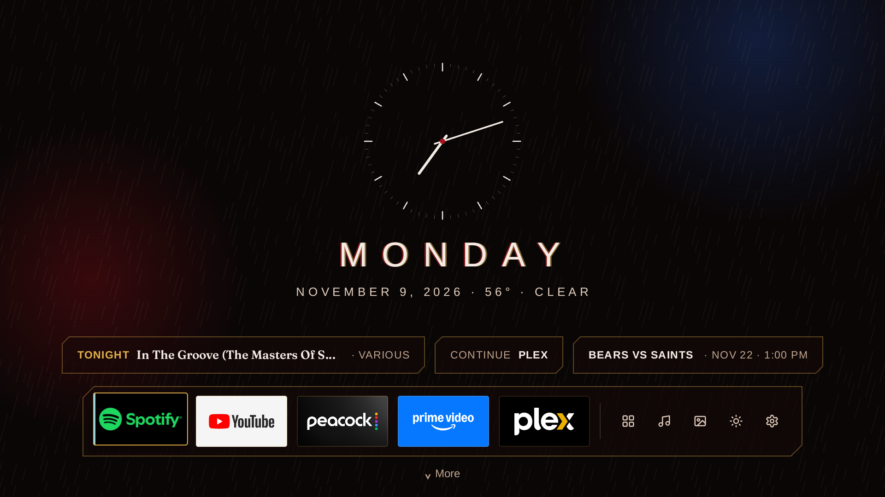

# Neon Noir Launcher

A music-first home screen for Google TV, built on the [CleanYourTV](https://github.com/Gathin23/cleanyourtv)
launcher. It has a hairline analog clock, a dock of up to six favorite apps, a Live guide in place of Google TV's Live tab, a Jazz mode
built around the turntable and your Discogs collection, Art Mode (also the TV's screensaver) after 15 idle minutes, and a night mode on a
schedule you set (9 PM to 6 AM by default). Dark mode is the default and light mode is one button away.

**Your record collection on your TV.** Neon Noir reads your [Discogs](https://www.discogs.com) collection and
picks tonight's record from it: the jazz, crooners and vocal pop you own. The pick is on the Home screen, and
Jazz mode puts it on the turntable, where Pick another chooses a different one for the rest of the day. The
collection is read again every Sunday at midnight, so new records show up within a week. All it needs is your
Discogs username (and an optional token) in `secrets.properties`. As far as we could find, it's the only TV home
screen that does this.

This is one person's home screen, shared for anyone who wants to build their own. Take whatever is useful.

Target TV: TCL 75QM7L Pro (Google TV 14, 4K).

## Two parts, two speeds

| Part | What it is | Needs a rebuild? | Where it can be shared |
| --- | --- | --- | --- |
| `theme/neon-noir/` | A CleanYourTV theme: a `config.json` plus three code-drawn wallpapers (morning, evening, night) | No: pushed with `scripts/push-theme.sh` | A pull request to CleanYourTV's `themes/` |
| `launcher/` (the full launcher) | Our own fork of the CleanYourTV launcher: Live guide, Jazz mode, Scores, Picks, Spotify, Discogs, light/dark toggle | Yes | A row in CleanYourTV's `SHOWCASE.md` |

The theme gets most of the look onto the TV on day one, with no code. The fork adds the features a
theme can't, because the reference launcher has no network access and themes only change its look.

## Status (Nov 12, 2026)

Running daily on the TCL as its Home screen: Home (clock, day name, date with weather, Tonight, Continue and
Scores chips, favorites dock, More), sky glows that follow the time of day, night mode on set times, All apps, Jazz
mode, More (Picks for you, Scores, Live) and Art Mode. The TCL remote's gear and app buttons are mapped. Weather,
Discogs, Scores and Picks need their settings in `secrets.properties` (see `docs/BUILD.md`). Not built yet: Spotify
playback control (Jazz mode opens Spotify and its playlists instead). App ID: `io.github.chrehor36.neonnoir`.

## What's in this folder

- `launcher/`: the launcher's Android code (CleanYourTV's launcher plus the Neon Noir Home). Open this folder in Android Studio to build. See `docs/BUILD.md` and `docs/PHASE1.md`.
- `tools/`: CleanYourTV's helper scripts, which `launcher/build-and-install.sh` uses.
- `theme/neon-noir/`: the CleanYourTV theme. `make_wallpapers.py` redraws the pictures.
- `design/tokens.json`: every color, font and spacing rule, dark and light, from the mockups.
- `android/res/values/nn_colors.xml`: the same colors as Android resources, ready to drop into the fork.
- `docs/SPEC.md`: what each screen does, and the mockup it matches.
- `docs/SETUP.md`: day-one steps on the TV, in order.
- `scripts/tv-day-one.sh`: read-only checks and backups from the TV (model, packages, display, memory).
- `scripts/push-theme.sh`: pushes the theme to the TV.
- `secrets.properties.example`: the keys the launcher needs. Copy it to `secrets.properties`, which Git ignores.

## Services it connects to

Spotify (opened with its own links; no account in the launcher), Discogs (the record picker), TMDB (Picks for
you), Open-Meteo (weather, sunrise and sunset; no account), ESPN's public scoreboard feed (unofficial), and the
Art Institute of Chicago's open API (Art Mode's public-domain paintings; no account). Nothing else, and no
analytics.

## Credits and license

MIT, see `LICENSE`. Built on the CleanYourTV launcher by [Gathin](https://github.com/Gathin23) (MIT,
`launcher/LICENSE-CleanYourTV.txt`). The wallpapers are CC0. Fonts: Arimo and Fraunces (SIL Open Font License).
Icons drawn after [Lucide](https://lucide.dev) (ISC). Art Mode's paintings come from the
[Art Institute of Chicago](https://www.artic.edu/open-access) open-access collection (public domain), fetched
on the TV, not stored here.
